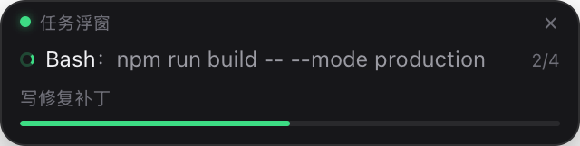
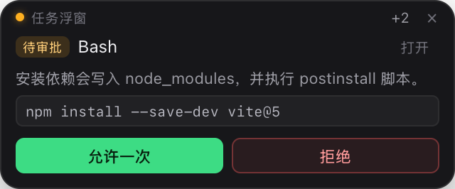
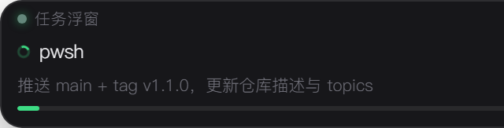

# dsh-float-panel · always-on-top task window for DeepSeek Harness

*[中文说明](README.md)*

Once DSH starts a task, a small system-level floating window stays on top of whatever you are doing: whether the agent is still working, what it is doing right now, and which step it is on. Approvals and multiple-choice questions can be answered straight from the window. When the task finishes, the window turns into "done" — click once to jump back to that conversation in DSH.

| Running | Waiting for approval |
| --- | --- |
|  |  |

The first two come from macOS. Windows renders the same card with the same page; only the window shell differs:



## Install

Requirements: **macOS 13+** (native AppKit panel) or **Windows 10 1903+ / Windows 11** (native WPF + WebView2 panel; needs the WebView2 Runtime and .NET Framework 4.8, both preinstalled on Windows 11 and most Windows 10 machines), plus DSH `>=0.2.0-rc.2`.

**One package serves both systems.** The repo ships the prebuilt macOS universal binary and `DSHFloatPanel.exe` for Windows, so installing needs no Xcode, no Visual Studio and no build step; the host picks the shell for the current `process.platform` at runtime.

```bash
dsh plugin --profile web add github:FlowRiver1/dsh-float-panel
```

Restart DSH afterwards and the plugin shows up in Settings → Plugins.

Local development uses a link install instead:

```bash
dsh plugin --profile web add link:/path/to/float-panel
```

## Usage

- The window appears in the bottom-right corner after you send a request; drag it anywhere, the position is remembered. It is anchored by its bottom edge, so a taller card grows upward instead of pushing toward the Dock.
- Set `config.autoOpen: false` to stop it opening automatically; the "◍ 任务浮窗" button at the bottom-right of DSH brings it back.
- The **×** only closes the window, it never interrupts the task.
- One conversation at a time is shown (approval > question > running > done); the rest collapse into a `+N` counter.
- Finished tasks stay for 30 minutes; clicking "open" removes them.
- On Windows the only difference is cosmetic: the rounded card is produced by clipping the window region (no soft drop shadow), the drag strip is still the top 22px, the panel never steals focus from the app you are typing in, and it stays out of the taskbar and Alt+Tab. "Open" first tries to activate the DSH window directly and falls back to the `dsh://open` protocol.
- Without the WebView2 Runtime the window does not appear: a dialog explains what to install, and the in-page button shows the reason. The task itself is unaffected.

## How it works

`index.js` is the host half: it folds the committed `session/event` log into a tiny snapshot of "what is this task doing right now" and serves it over `/float-panel/*` routes on DSH's existing web port. `client.js` is the page half: it reports which conversation is on screen and turns clicks in the window into real `answer()` calls. `panel.html` is the window UI (one UI for both platforms; it talks to WKWebView on macOS and WebView2 on Windows). The shells are `native/main.swift` (AppKit `NSPanel` + `WKWebView`) and `native/windows/Panel.cs` (WPF + WebView2) — an Electron renderer cannot create an always-on-top window, so each platform gets a ~500-line native shell that the host spawns.

Because the host is the single source of truth, the panel stays accurate even when the DSH page is in the background or not open at all.

## Building the shells

Both shells are prebuilt and committed; only rebuild after changing their source.

**macOS** (`native/main.swift`, needs the Xcode command line tools): `cd native && ./build.sh`.

**Windows** (`native/windows/Panel.cs`, needs only the in-box .NET Framework, no SDK):

```powershell
powershell -ExecutionPolicy Bypass -File native/windows/build.ps1
```

The script compiles with `%WINDIR%\Microsoft.NET\Framework64\v4.0.30319\csc.exe`; the WebView2 managed assemblies and the `x64/` / `arm64/` `WebView2Loader.dll` are committed alongside it and fetched from NuGet only when missing. `-Console` builds a `DSHFloatPanel-debug.exe` that prints startup failures to a terminal.

## Limits

- The floating window needs a native system window: macOS 13+ and Windows 10 1903+ / 11. On Linux only the in-page wake-up button exists, and it reports that the platform is unsupported.
- Windows requires the WebView2 Runtime; without it the window is skipped with a dialog and a hint in the page, and the task is unaffected.
- Free-text answers are not editable in the panel — it offers a "go answer" shortcut instead.
- Approvals must be settled by the page, so the window needs the DSH page to have been opened at least once (always true on desktop).

## Privacy

The plugin reads local session state only. Nothing is sent anywhere: no telemetry, no analytics. Every route lives on DSH's own web port, and `panel` / `state` / `action` require a 32-character token stored at `~/Library/Application Support/dsh-float-panel/token` on macOS or `%LOCALAPPDATA%\dsh-float-panel\token` on Windows; the remaining routes accept loopback origins only and validate `Origin`. On Windows the WebView2 user data folder lives in that same state directory (`webview/`, 10–50MB) and falls back to `%TEMP%\dsh-float-panel-webview`, then to the plugin directory, if the state directory is not writable; `panel-error.log` records the reason.

## License

[MIT](LICENSE)
