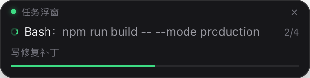
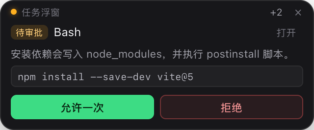
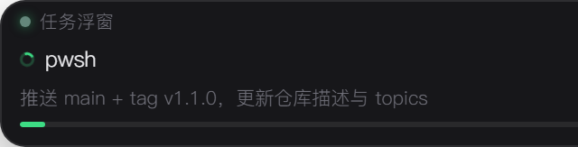

# 任务浮窗 · dsh-float-panel

*[English](README.en.md)*

DSH 发起任务后，你切到任何软件都能看到一个系统级置顶小窗：现在在不在干活、在干什么、走到第几步；需要你审批或回答时直接在浮窗上点；任务完成后浮窗变「已完成」，点一下回到 DSH 对应会话看结果。

## 它解决什么

| 你原来的问题 | 浮窗里的表现 |
| --- | --- |
| 切走后不知道 AI 还在不在干活 | 顶部状态点 + 「正在执行 Bash：npm test」这类实时步骤 |
| 不知道整体进度 | 有任务清单时显示进度条和小标题（3/7 · 正在写修复补丁） |
| 审批弹窗在软件里，人在别的窗口 | 浮窗直接给「允许一次 / 拒绝」按钮，点完立即生效 |
| 需要你回答的选择题 | 单选题直接给选项按钮，点一下就提交 |
| 不知道是否已经完成 | 完成后状态变「已完成」，并显示结果前两行预览 |
| 完成后要自己找会话 | 「打开查看结果」一键激活 DSH 并跳到该会话 |

## 外观

320pt 宽、高度跟内容走，默认贴在右下角，只占一小块：

| 状态 | 样子 |
| --- | --- |
| 进行中 |  |
| 待审批 |  |
| 待回答 |  |
| 已完成 |  |

上面四张取自 macOS。Windows 是同一张卡片、同一套渲染，区别只在窗口壳：



## 安装

要求：**macOS 13+**（原生 AppKit 窗口）或 **Windows 10 1903+ / Windows 11**（原生 WPF + WebView2 窗口，需要 WebView2 Runtime 与 .NET Framework 4.8；Win11 与绝大多数 Win10 自带），DSH `>=0.2.0-rc.2`。

**一份包同时支持两个系统**：仓库里带好了 macOS 的通用二进制（Apple Silicon + Intel）和 Windows 的 `DSHFloatPanel.exe`，安装时不需要 Xcode、不需要 Visual Studio、不需要任何编译步骤；装完由插件按 `process.platform` 自己选对应的壳。

```bash
dsh plugin --profile web add github:FlowRiver1/dsh-float-panel
```

装完重启 DSH，在 Settings → Plugins 里能看到 `dsh-float-panel`，配置项见下面的「配置」。

本地开发/试用时用链接安装，改代码即时生效：

```bash
dsh plugin --profile web add link:/path/to/float-panel
```

> 桌面版（dsh-desktop 等）的 profile 由 Electron 应用托管，同样用 `dsh plugin --profile <名字> add ...` 加包，重启应用后生效。

## 用法

- 发出一条请求后浮窗自动出现在右下角，可以拖动到任意位置，位置会记住（窗口以底边为锚点向上长，不会越变越往下顶到 Dock / 任务栏）。
- 不想自动出现时，把 `config.autoOpen` 设为 `false`；随时可以点 DSH 界面右下角的「◍ 任务浮窗」把它叫回来。
- 浮窗右上角 × 只关闭窗口，不打断任务；DSH 应用的右下角按钮仍在。
- 浮窗只显示「此刻最需要你看」的那一个会话（审批 > 提问 > 进行中 > 已完成），其余只留顶部 `+N` 计数，避免占屏幕。
- 窗口高度跟内容走：空着 57pt、进行中约 80pt、带审批按钮约 140pt，永远比一张卡片大不了多少。
- 已完成的任务保留 30 分钟，点「打开」后从浮窗移除。
- Windows 上与 macOS 的差别只有外观：窗口用圆角区域裁剪（没有 macOS 的柔和投影），拖拽条同样在顶部 22px；浮窗不会抢走你正在用的软件的焦点，也不占任务栏、不进 Alt+Tab。点「打开」时先尝试直接激活 DSH 窗口，失败再走 `dsh://open` 协议。
- Windows 缺 WebView2 Runtime 时，浮窗不会出现，会弹窗提示安装，DSH 页面右下角的「◍ 任务浮窗」按钮也会显示原因，任务本身不受影响。

## 结构

```
index.js          Host 半：把 session/event 折叠成面板状态，提供 /float-panel/* 路由
client.js         页面半：上报当前会话、执行浮窗发来的审批/回答/打开指令、右下角唤醒按钮
panel.html        浮窗页面（深色卡片；macOS 走 WKWebView 桥，Windows 走 WebView2 桥）
native/main.swift     macOS 原生壳：NSPanel + WKWebView，构建产物 DSH Float Panel.app
native/windows/       Windows 原生壳：WPF + WebView2，构建产物 DSHFloatPanel.exe
cordis.patch.yml      安装到 profile 时插入的 loader 条目
```

Host 是状态的唯一来源：它订阅 `session/event`（turn/start、tool/call、todo/write、approval/asked、turn/end…），所以即使 DSH 页面在后台、甚至没打开，浮窗照样准确。页面半只负责三件事：告诉 Host 当前看的是哪个会话、把浮窗上的点击换算成真正的 `answer()` 调用、以及收到「打开」指令后切会话。

## 路由

全部挂在 DSH 现有的 Web 端口上，不额外监听：

| 路由 | 作用 |
| --- | --- |
| `GET /float-panel/panel?t=` | 浮窗页面本身 |
| `GET /float-panel/state?t=` | 面板状态快照（轮询兜底用） |
| `POST /float-panel/action?t=` | 浮窗上的审批 / 回答 / 打开 |
| `GET /float-panel/events` | SSE：状态推送与指令下发 |
| `POST /float-panel/panel/open` · `/panel/close` | 启动 / 关闭原生浮窗 |
| `POST /float-panel/current` | 页面上报当前会话 |

`panel` / `state` / `action` 三条需要 32 位随机 token（macOS 存在 `~/Library/Application Support/dsh-float-panel/token`，权限 0600；Windows 存在 `%LOCALAPPDATA%\dsh-float-panel\token`）；`events`、`current`、`panel/open` 只接受本机来源，并校验 Origin。

## 原生壳构建

两套壳都已经构建好并提交在仓库里，普通安装不需要自己编译；只有改了对应源码才要重建。

**macOS**（`native/main.swift`，需要 Xcode 命令行工具）：

```bash
cd native && ./build.sh
```

产物是 `native/DSH Float Panel.app`（universal，arm64 + x86_64，ad-hoc 签名、`LSUIElement` 无 Dock 图标）。窗口用 `NSPanel` + `.nonactivatingPanel`，所以点击浮窗不会把 DSH 提到前台；顶部 22px 是原生拖拽条，页面渲染完会把自己的高度告诉原生壳（`postMessage {type:'resize'}`），窗口朝下伸缩、顶边不动。

**Windows**（`native/windows/Panel.cs`，只需要 Windows 自带的 .NET Framework，不需要 Visual Studio 或 .NET SDK）：

```powershell
powershell -ExecutionPolicy Bypass -File native/windows/build.ps1
```

产物是 `native/windows/DSHFloatPanel.exe`（约 24KB）加同目录的 WebView2 SDK 程序集。脚本用 `%WINDIR%\Microsoft.NET\Framework64\v4.0.30319\csc.exe` 编译；WebView2 的托管 DLL 和 `x64/`、`arm64/` 下的 `WebView2Loader.dll` 已随仓库提交，缺失时脚本会自己从 NuGet 拉一次。`-Console` 开关编出带控制台的调试版（`DSHFloatPanel-debug.exe`），方便看启动失败原因。

Windows 壳与 macOS 壳一一对应：`WS_EX_NOACTIVATE | WS_EX_TOOLWINDOW` + `HWND_TOPMOST` 对应 `.nonactivatingPanel`，顶部 22px 由页面把 `mousedown` 转成 `{type:'drag'}`（WebView2 里没有原生拖拽条可用），窗口高度同样由页面 `{type:'resize'}` 驱动；圆角用 `CreateRoundRectRgn` 裁剪窗口区域，避开 WebView2 在分层透明窗口里的合成问题（代价是没有柔和投影）。

## 配置

```yaml
- insert:
    - id: float-panel
      name: 'dsh-float-panel'
      config:
        autoOpen: true   # 任务开始时自动显示浮窗
```

## 限制

- 浮窗需要系统原生窗口：macOS 13+ 与 Windows 10 1903+ / 11 可用，**Linux 上只有 DSH 页面内的唤醒按钮**（点击会提示「此系统暂不支持浮窗」）。
- Windows 需要 WebView2 Runtime；缺失时浮窗不会出现，会弹窗并提示安装，任务本身不受影响。
- 「需要你输入一段文字」这类回答不在浮窗里编辑，只给「去回答」入口跳回 DSH。
- 审批必须由页面结算，所以浮窗点击要求 DSH 页面至少打开过一次（桌面端默认总是满足）。

## 隐私

- 插件只读**本机** DSH 会话的状态事件，把结果画在浮窗里；不向任何外部服务发送数据，没有遥测、没有统计上报。
- 所有路由挂在 DSH 自己的 Web 端口上，不额外监听。`panel` / `state` / `action` 需要 32 位随机 token（macOS：`~/Library/Application Support/dsh-float-panel/token`，Windows：`%LOCALAPPDATA%\dsh-float-panel\token`）；`events`、`current`、`panel/open` 只接受本机来源并校验 Origin。
- token、`panel.pid`、窗口位置等运行状态文件都在上面那个状态目录里，不进仓库。Windows 的 WebView2 用户数据目录默认也在那里（`webview/`，约 10–50MB）；如果该目录不可写（例如更严格的沙箱），会依次退到 `%TEMP%\dsh-float-panel-webview`，最后退到插件自己的目录，并在 `panel-error.log` 里记一行原因。

## License

[MIT](LICENSE)

